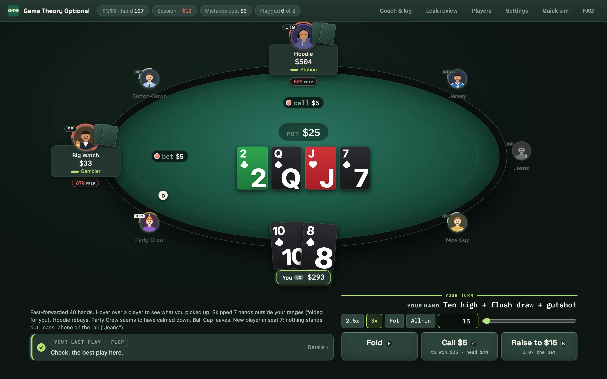
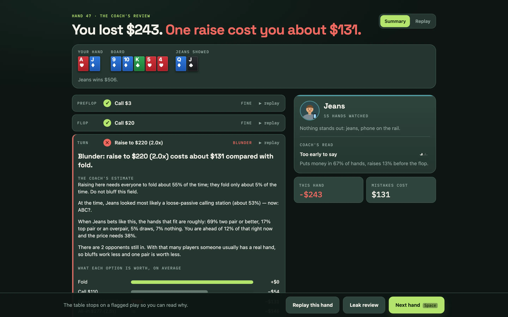
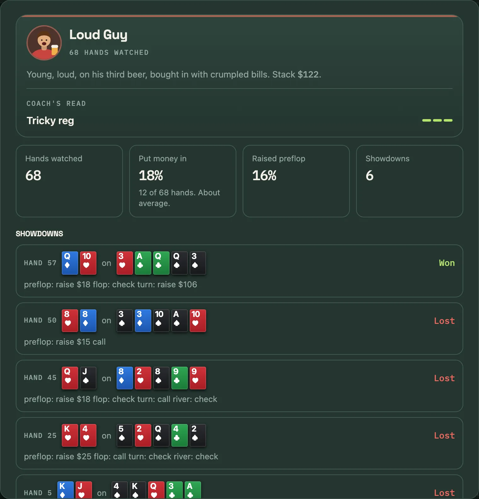
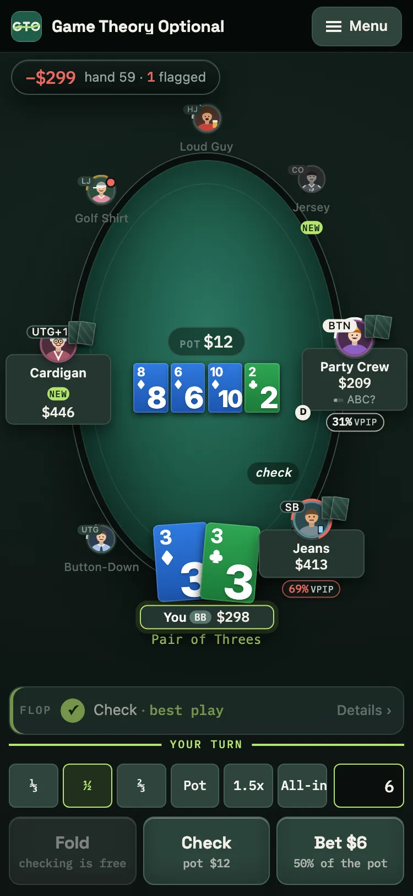
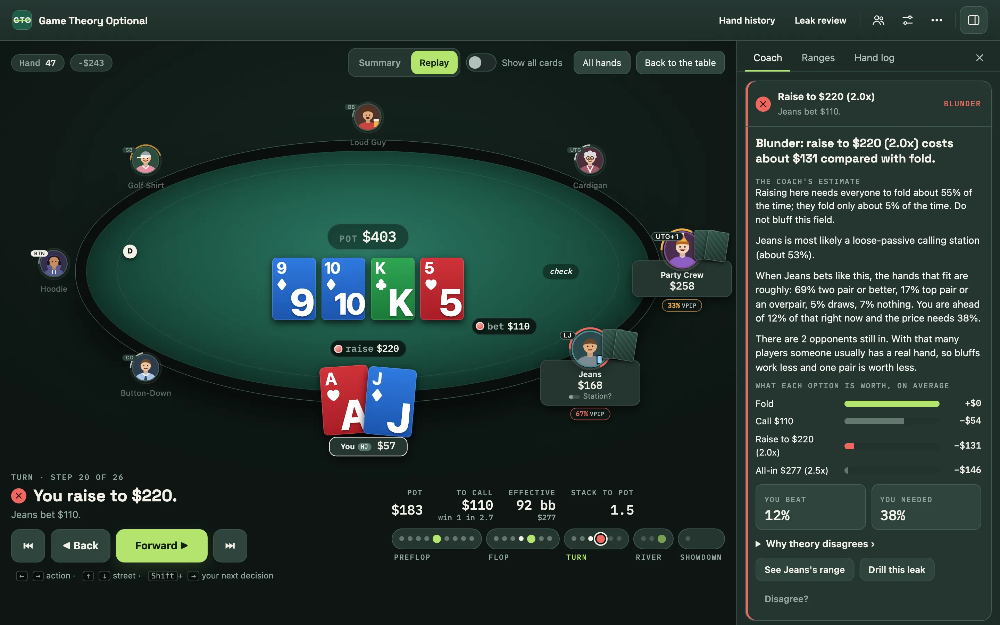
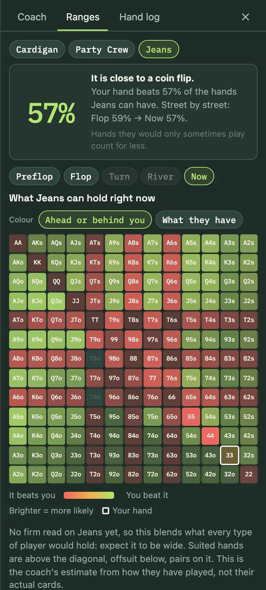
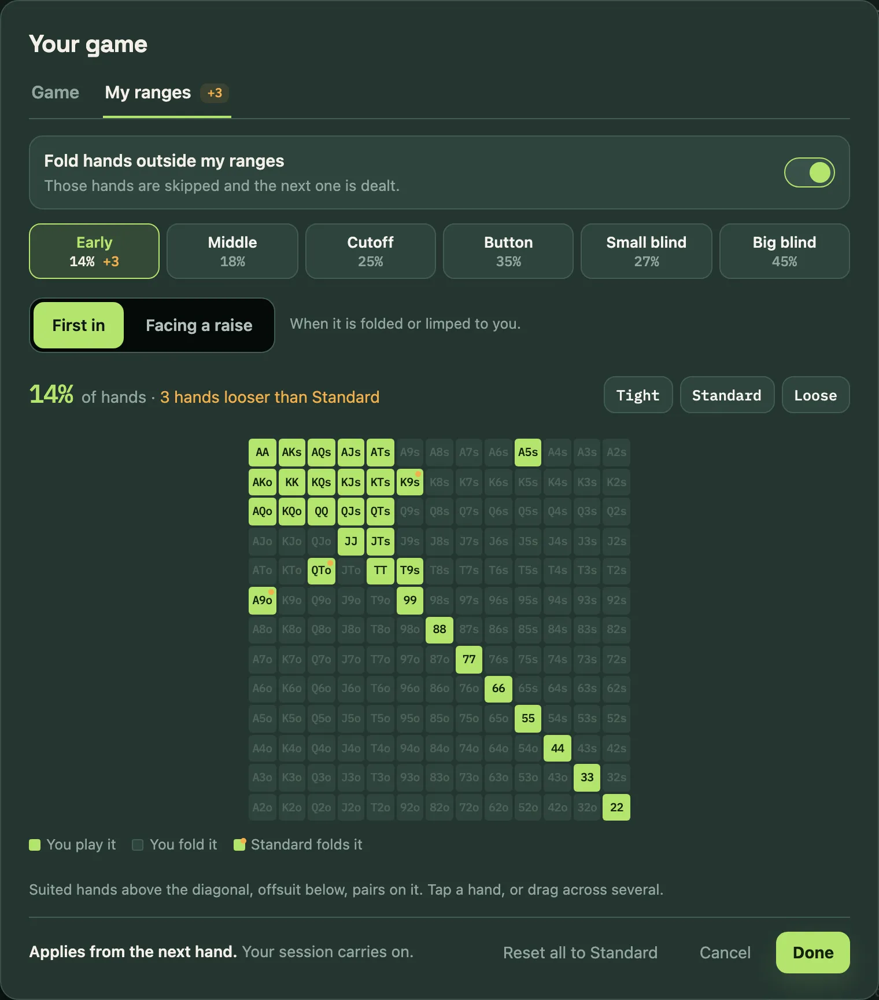

# Game Theory Optional

<picture>
  <source media="(prefers-color-scheme: dark)" srcset="assets/logo/wordmark.svg">
  
</picture>

*GTO usually stands for game theory optimal. At your table, it's optional.*

### ▶ Play it now: [pizzafx.github.io/poker_trainer](https://pizzafx.github.io/poker_trainer/)

Free, in your browser, nothing to install.

Game Theory Optional is a free poker trainer for the games you actually sit in: the
low-stakes game at your local casino and the home game with your friends.

You play no-limit hold'em in your browser against the kinds of players who really show up.
Every decision is scored by **how much money it makes against those players**, not by what
a solver would do. A play that is perfect in theory still gets flagged if it loses money
against a calling station, and a play a solver hates gets a green tick if it prints.

There are two ways to play:

- **Casino table.** An eight-handed live $1/$3, $2/$3, $2/$5 or $3/$5 game with the mix of regulars,
  retirees and gamblers you find in a card room, real rake, and players who come and go.
- **Home game.** Your own blinds and buy-in, and you choose who sits down: three maniacs, two
  nits and a total beginner, say. No rake, everyone rebuys, and nobody leaves.

[](https://pizzafx.github.io/poker_trainer/)

New here? The app has an **FAQ** (under More (⋯) in the header, or Menu on a phone, or [`faq.html`](faq.html)) written
for poker players: how decisions are graded, what the colours mean, and how far to trust it.

## Why not just study GTO?

Solvers assume opponents who bluff the right amount, fold the right amount and punish every
mistake. Low-stakes casino players and home-game regulars do none of that. They limp, call too much, rarely bluff
rivers, and almost never raise without a real hand. The profitable adjustments are large and
often the opposite of theory:

- fold one pair to a passive player's raise, however strong it looks
- bet bigger and thinner for value against players who do not fold
- stop bluffing people who call with any pair
- raise big over limpers instead of limping along

This trainer drills those adjustments by letting you make the decision and then showing what
it cost.

## Quick start

**Play in your browser: [pizzafx.github.io/poker_trainer](https://pizzafx.github.io/poker_trainer/)** (nothing to install).

Or run it on your own machine:

```bash
git clone git@github.com:pizzafx/poker_trainer.git
cd poker_trainer
./start.sh
```

Then open http://localhost:5173 and press **Deal me in** (or go straight to
http://localhost:5173/play.html).

`start.sh` (macOS and Linux) uses the Node.js on your machine if it is version 18 or newer.
If not, it downloads an official Node.js build from nodejs.org into the project folder
(`./.node`, about 45 MB, checksum-verified) and uses that. Nothing is installed system-wide.
On Windows, install Node.js 18 or newer from https://nodejs.org and run `npm start`. There
are no other dependencies and no build step.

| Key | Action |
|---|---|
| `F` | Fold |
| `C` | Check or call |
| `R` | Bet or raise the amount shown |
| `Space` | Next hand (only needed after a flagged play) |

Click any opponent to see what you have observed about them.

## How a decision is judged

1. **Reads.** Each opponent has a hidden style and a visible look (ball cap and coffee, hoodie
   and headphones, loud guy on his third beer) that only loosely predicts it. As they bet,
   call, fold and show down hands, the trainer updates what an attentive player could
   conclude about them. That read, not the hidden truth, is what you are judged against.
2. **Ranges.** For every opponent still in the hand it works out which hands fit the way
   that kind of player has played so far.
3. **Run-outs.** It deals the opponents hands from those ranges and plays each of your
   options to the end of the hand, 800 to 3,000 times, on the same cards for every option.
4. **Verdict.** If your choice clearly loses money compared with the best option, it is
   flagged as a mistake (yellow) or blunder (red), with the cost in dollars, what the
   opponent's range looks like, and why theory disagrees.

A flag has to hold up, not just win on average. The coach re-checks it with the opponents
calling a little looser and a little tighter, and with their ranges read stronger and weaker;
if your play is only worse under some of those, it is not graded. Pots with several players
have their own rules: checking one pair or a draw into a crowd is usually a note, not a flag
(it can still be yellow when it gives up a lot), and plays that only score well against these
particular opponents, like raising a draw into a bettor and a caller, are left green with a
"not a habit to build" note. Under most flags and notes, **the coach's estimate** says in one
line what the play needed and what it got: "this bet needs everyone to fold about 45% of the
time; they fold about 15%", or "when called you are ahead about 80% and need 45%".

The grading runs in the background, so the table never freezes while the coach is thinking.

Hands deal on automatically while your play is green. Anything flagged stops the table and
opens the coach's review of the hand, with the flagged play open: what it cost, what the
opponent's range looks like, and what each option was worth.



<p>
  
  &nbsp;
  
</p>

*Click or tap a player for their card: the coach's read, how often they put money in, and
every hand they have shown. On a phone the table turns into a tall oval with the buttons
under your thumb.*

## Step back through any hand



Your last 100 hands are kept in your browser. Open **Hand history** (or "Replay" from any
review) and step through a hand action by action, with the pot, the price and the coach's
verdict at each of your decisions, the opponents' ranges as they stood at that moment, and
"Show all cards" to see what everyone held.

## See the range



The **Ranges** tab answers "how am I doing against this player?" at a glance. The headline
is the share of their likely hands your hand beats after the flop (with how it has moved
street by street), and before the flop your equity: how often your two cards win against
that range if all five board cards are dealt. Hands they would only sometimes play count for
less. The chart colours each hand from red (it beats you) through amber to lime (you beat
it), brighter for the hands they are more likely to have; or switch to what each hand is on
this board. It updates with every action, and the street buttons step back through the hand
so you can watch a range narrow.

## The opponents

| Type | In one line |
|---|---|
| Tight-passive nit | Waits for big hands. When the money goes in, he has it. |
| Straightforward recreational | Bets when he hits, gives up when he misses. |
| Calling station | Sees lots of flops and hates folding a pair or a draw. |
| Gambler | Plays most hands, calls far too much, fires the odd wild bluff. |
| Maniac | Raises and barrels constantly. Big bets mean much less from him. |
| Solver-style player | Small bets, balanced bluffs, by the chart whoever he faces. |
| Solid regular | Tight-aggressive grinder who isolates limpers. |
| Tricky regular | Plays many hands in position and applies pressure. |

Every player is their own variation of a type: a little looser or tighter, more or less
sticky. They buy in for different amounts (some sit short), leave, get replaced, and go on
tilt after losing a big pot. The table also remembers you: raise and bluff a lot and you
start getting called lighter.

## Features

- **My ranges.** Set the hands you open from each seat and the hands you play against a raise,
  starting from Tight, Standard or Loose or painting your own on the hand chart; with "Fold hands
  outside my ranges" on, everything else is folded for you. Each seat shows how much looser than
  Standard you are, with an amber dot on every hand Standard folds. Changes apply from the next
  hand, and your session carries on. Open it from "Your game and ranges", or from any "Edit my
  ranges" link in the Hand log or under a tip.

  
- **Coach strip** under the table: one line with your last play and its grade ("✓ Raise to
  $15 · fine", "! Call $25 · mistake −$12"). Tap it for the full reasoning in the side panel,
  with the numbers behind it. On a wide screen, drag the panel's left edge (or focus it and use
  the arrow keys) to widen it and read the range chart bigger; the table shrinks to make room.
  Double-click the edge to reset.
- **Hand history and replayer.** Your last 100 hands, kept in your browser, filterable by
  flagged, played and folded. Step through any of them action by action with the coach's
  verdicts and the ranges at each step, or "Show all cards".
- **Hand log.** The current hand street by street in the side panel, with each of your
  decisions and its grade; earlier hands from tonight open in the replayer.
- **Session carries on after a reload.** Close the tab or reload mid-session and the table picks
  up at the next hand. One browser tab owns the table at a time; another tab offers to take over.
- **Session placard** on the corner of the table: the session result, the hand number, and what
  mistakes have cost. Click it for Leak review.
- **Range view.** The Ranges tab draws an opponent's likely hands on the 13x13 hand chart and
  updates as the hand goes on, so you can watch a range narrow street by street. It leads
  with how you stand against that range (your equity before the flop, the share you beat
  after it) and colours each hand by whether you are ahead of it, or by what it is on this
  board.
- **Hand review.** After a flagged hand the coach's review opens: the result and what the
  mistakes cost, the run-out, every decision with the flagged ones open, and the opponent's
  card. Space deals the next hand.
- **Leak review.** Mistakes are grouped into types (paying off, bluffing callers, missed
  value, sizing, preflop too loose or too passive, and more), ranked by cost, and tracked
  across sessions in your browser.
- **Tips, not flags, for habits.** Limping first in, opening a hand outside the Standard range
  for your seat, and re-raising with a hand that is mostly a bluff get a green tip rather than a
  flag. They add up under "Habits the coach noted" in Leak review.
- **Disagree?** Think the coach got a flagged play wrong? The button on the verdict makes a
  report of the hand (cards, action, the coach's reads, every option's numbers, and once the
  hand is over what everyone held) with what you would have done and why. Copy it into a
  message, save it as a file, or open a prefilled GitHub issue (public, and needs a GitHub
  account). Nothing is sent from the page itself.
- **Drill mode.** Pick a leak and the trainer deals only that kind of spot, one after
  another, playing the earlier streets for you. One decision, one verdict, next spot.
- **Home game mode.** Pick it in "Your game and ranges": Game → Where do you play? → Home game.
  Set whole-dollar blinds and a buy-in,
  then say how many of each player type to seat (one to eight opponents). You know who is
  coming but not which seat is which. Includes a "total beginner" type that only appears
  in home games.
- **Players screen.** Sliders for how each opponent type plays: hands played and raised,
  bluffing, what they call with, what they never fold, how common they are. Saved in your
  browser; no file editing needed.
- **Table types.** Typical, aggressive, conservative, or loose-passive: the same player
  types in a different mix.
- **Game settings.** $1/$3, $2/$3, $2/$5 or $3/$5, buy-in, and rake (a typical 10% capped rake
  by default, plus a stepped structure with a jackpot drop, a flat drop, or none). None of it is
  needed to start: the table deals you in on sensible defaults.
- **Quick sim.** Plays 40 hands in an instant so you start with something observed about
  every player. It is on the placard before your first hand, and under "More" in the header.
- **Works on a phone.** Below 900px wide the header folds into a Menu and the coach panel moves
  below the table, so nothing covers it. On a phone-sized screen (600px and narrower) the table
  becomes a tall oval and Fold, Call and Raise stay pinned to the bottom of the screen. A tap on
  a player opens their card; "Your game and ranges" opens as a full-screen sheet.
- **Bet sizes in dollars.** Before the flop the size chips show dollar amounts (the rule, "3x
  the big blind plus one for each limper", is in the tooltip), and the last chip is always
  "All-in", with the exact amount and whom it covers in its tooltip.
- **Your hand in words.** From the flop on, the trainer names what you hold above the bet
  slider: "Pair of Sevens", "Two Pair, Kings and Sevens", "Queen high", plus any draw.
- **VPIP at a glance.** Once you have watched a player for eight hands, a ring around their
  avatar fills to how often they put money in, and a pill under their name plate shows the
  number: grey for tight, white for average, amber for loose, red for playing almost
  everything. The count behind it ("18 of 41 hands") and what it means are in the hover box
  on the pill, and on the player's card.
- **Player notes.** Hover over a seat for what you have seen that player do (how loose,
  how aggressive, the last hand they showed) and the coach's read in words. Click or tap for
  the full card: every showdown and how they played it, plus a spoiler button for their true
  style.

## How far to trust it

Read this before taking the advice to a real table.

- **Only preflop tendencies are measured.** The one tracked sample of these games found
  about 35% of hands played, 6% raised preflop, four players to the flop, and limpers
  calling a raise 56% of the time. The opponents match it: about 35% of hands played,
  7% raised, and three and a half players per flop. Nothing after the flop has been measured at these
  stakes, so every postflop number in `src/bots/profiles.js` is expert judgement in the
  direction coaches agree on. Some of it has been checked against a three-player solver on the
  river and turn, none of it against live hand data.
- **The opponents are easier to beat than real players.** A player who blindly follows the
  top-rated option wins about two to four times what a strong live player makes: about 55 big
  blinds per 100 hands here, against 15 to 30 for a strong player in a real game. Trust the direction
  of the advice (value-bet more, pay off less, isolate limpers) more than the dollar
  figures.
- **Guardrails limit what gets flagged.** You are never marked down for declining a
  bluff-raise or a re-raise bluff, or for not betting more than the pot. With one pair the
  reference bet is the best one up to three-quarters of the pot, and with several players in a
  bet of 45% of the pot or more is never "too small". A bluff you pass up is only flagged
  against players who can fold, and only by a wide margin. Preflop folds are only flagged
  with hands in the Tight preset for your seat. A check before the river is never red (except a
  turn check with two pair or better that closes the action), and checking one pair or a draw
  into several players is yellow at most, and only when it gives up a lot. When a play is waved
  through, the note says how much more the alternative scored. Those plays can score well
  against bots and lose money against people.
- **The numbers are estimates.** Options marked ≈ in the numbers table are too close to
  call.

The full research, with sources and a list of what could not be found, is in
[`reports/`](reports/).

## Checking the model

Everything the trainer believes can be inspected from the command line:

```bash
npm test                        # engine, grading rules, ranges, replayer, solver fixture
node scripts/spots.js           # the judge on 13 set-piece spots with known answers
node scripts/mwbench.js         # the coach on 26 multiway spots, against their expected grades
node scripts/calibrate.js       # stats that emerge from bot-vs-bot play, per player type
node scripts/audit.js 11 150    # hand histories behind the costliest verdicts
node scripts/selfplay.js        # win rate of a player who blindly follows the judge
node scripts/exploit.js         # where that player's profit comes from
node scripts/noise.js 3000      # how repeatable the judge's numbers are
node scripts/flagrate.js        # how often a sensible player gets flagged, and for what
```

`npm test` also runs the solver fixture tests: the balanced opponents checked against a
three-player river equilibrium. One pair folding more against a bet and a call, and a one-pair
value bet scoring about the same from half pot to 1.5 times the pot, are real tests. How often the
field folds to a half-pot bet is still too low; that check prints its numbers and is marked as a
known gap, so it does not fail the run.

Before committing a change to the site, run `node scripts/stamp.js`: it versions every asset URL
so browsers fetch a new version as a whole (the tests fail if you forget).

They play the game the app deals a new player ($1/$3, the typical casino rake, a $300 buy-in).
Add `--legacy` to any of them for the configuration used before November 2026 ($2/$3, with
the stepped rake for sessions and a 10% rake capped at $5 for set-piece hands), to reproduce
older numbers.

If you disagree with how a type plays, change it on the **Players** screen in the app.
The sliders cover the settings that matter most. Every number, including ones the screen
does not expose, is in `src/bots/profiles.js` with a comment; after editing that file, rerun
`calibrate.js` and `spots.js` to see the effect. (Changes made on the Players screen live in
your browser, so the command-line scripts do not see them.)

## Project layout

```
src/engine/    cards, hand evaluator, betting rules, hand-strength reading
src/bots/      opponent profiles and the decision model
src/trainer/   session, reads, judge, feedback text, drills
src/ui/        the page
scripts/       checks and diagnostics
reports/       the research report behind the opponent model
research_notes/ raw notes from each research thread
```

## Licence

The code is MIT licensed: see [`LICENSE`](LICENSE). The research report and notes in
`reports/` and `research_notes/` are included for reference and are not covered by it.
The two web fonts in `assets/fonts/` (Space Grotesk and IBM Plex Mono) are under the SIL Open
Font License 1.1, not MIT; their licence texts are beside them.

## Ideas for later

- separate player pools and opening sizes by stake (today the same players sit at every stake)
- raise size as a tell (the small "click-back" raise from a passive player)
- type in a real hand from last night and get the coach's view
- your own session stats with target ranges
- straddle options matching the room
