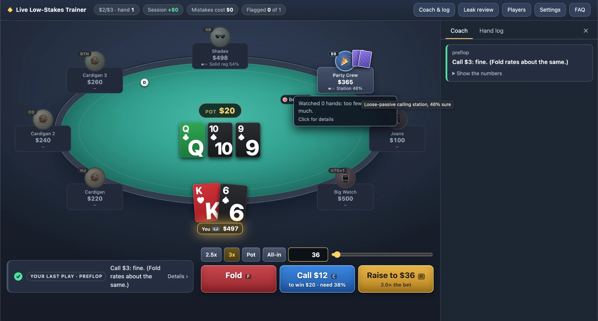
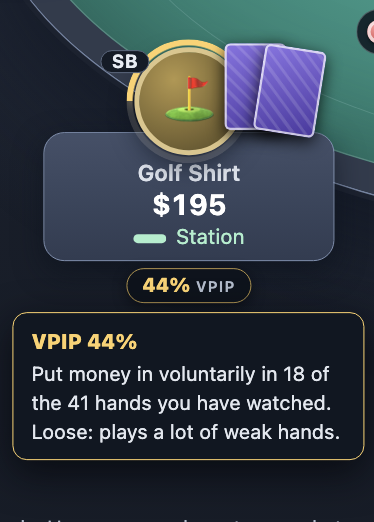
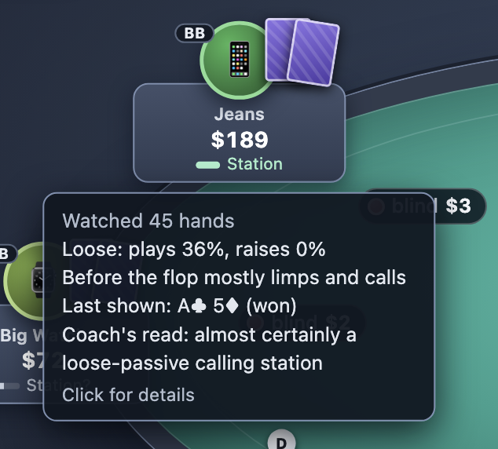
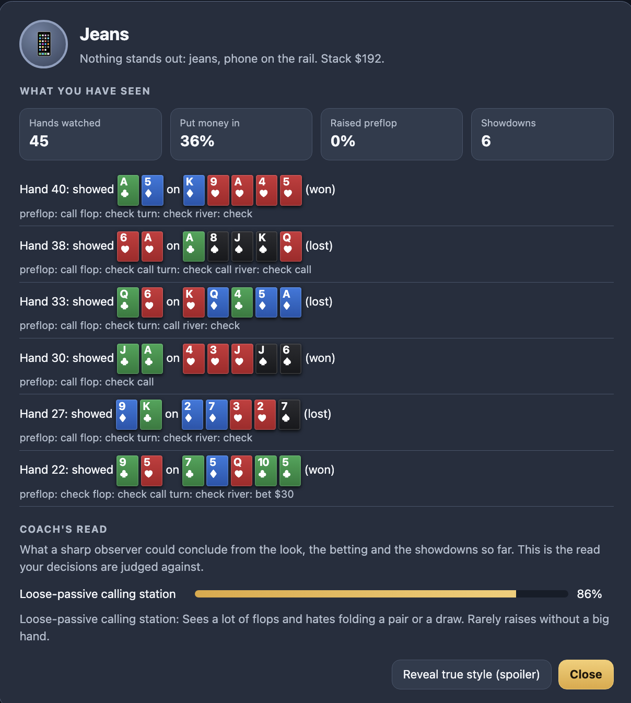
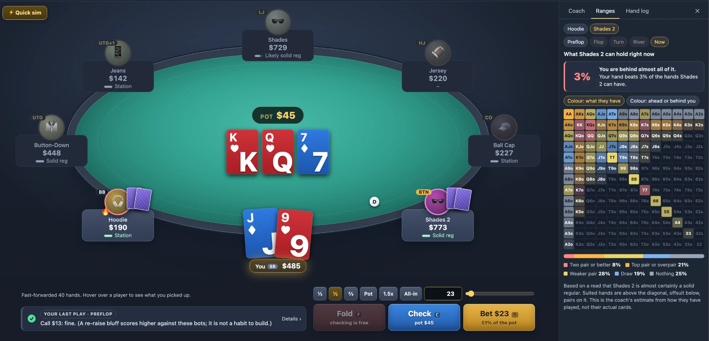

# Live Low-Stakes Trainer

A poker trainer for the games you actually sit in: the low-stakes game at your local casino
and the home game with your friends.

You play no-limit hold'em in your browser against the kinds of players who really show up.
Every decision is scored by **how much money it makes against those players**, not by what
a solver would do. A play that is perfect in theory still gets flagged if it loses money
against a calling station, and a play a solver hates gets a green tick if it prints.

There are two ways to play:

- **Casino table.** An eight-handed live $1/$3, $2/$3, $2/$5 or $3/$5 game with the mix of regulars,
  retirees and gamblers you find in a card room, real rake, and players who come and go.
- **Home game.** Your own blinds and buy-in, and you choose who sits down: three maniacs, two
  nits and a total beginner, say. No rake, everyone rebuys, and nobody leaves.



New here? The app has an **FAQ** (button in the header, or [`faq.html`](faq.html)) written
for poker players: how decisions are graded, what the colours mean, and how far to trust it.

## Why not just study GTO?

Solvers assume opponents who bluff the right amount, fold the right amount and punish every
mistake. Low-stakes casino players and home-game regulars do none of that. They limp, call too much, rarely bluff
rivers, and almost never raise without a real hand. The profitable adjustments are large and
often the opposite of theory:

- fold one pair to a passive player's raise, however strong it looks
- bet bigger and thinner for value against players who do not fold
- stop bluffing people who call with any pair
- raise big over limpers instead of limping along

This trainer drills those adjustments by letting you make the decision and then showing what
it cost.

## Quick start

```bash
git clone git@github.com:pizzafx/poker_trainer.git
cd poker_trainer
./start.sh
```

Then open http://localhost:5173.

`start.sh` (macOS and Linux) uses the Node.js on your machine if it is version 18 or newer.
If not, it downloads an official Node.js build from nodejs.org into the project folder
(`./.node`, about 45 MB, checksum-verified) and uses that. Nothing is installed system-wide.
On Windows, install Node.js 18 or newer from https://nodejs.org and run `npm start`. There
are no other dependencies and no build step.

| Key | Action |
|---|---|
| `F` | Fold |
| `C` | Check or call |
| `R` | Bet or raise the amount shown |
| `Space` | Next hand (only needed after a flagged play) |

Click any opponent to see what you have observed about them.

## How a decision is judged

1. **Reads.** Each opponent has a hidden style and a visible look (ball cap and coffee, hoodie
   and headphones, loud guy on his third beer) that only loosely predicts it. As they bet,
   call, fold and show down hands, the trainer updates what an attentive player could
   conclude about them. That read, not the hidden truth, is what you are judged against.
2. **Ranges.** For every opponent still in the hand it works out which hands fit the way
   that kind of player has played so far.
3. **Run-outs.** It deals the opponents hands from those ranges and plays each of your
   options to the end of the hand, 800 to 3,000 times, on the same cards for every option.
4. **Verdict.** If your choice clearly loses money compared with the best option, it is
   flagged as a mistake (yellow) or blunder (red), with the cost in dollars, what the
   opponent's range looks like, and why theory disagrees.

Hands deal on automatically while your play is green. Anything flagged stops the table so
you can read why.

<p>
  
  &nbsp;
  
  &nbsp;
  
</p>

*Each seat shows the player's VPIP: how often they voluntarily put money in the pot. Hover over a player for what you have
picked up; click for every hand they have shown.*

## See the range



The **Ranges** tab shows what the coach thinks an opponent can hold, on the standard hand
chart, and how much of it your hand beats. It updates with every action, and the street
buttons step back through the hand so you can watch a range narrow.

## The opponents

| Type | In one line |
|---|---|
| Tight-passive nit | Waits for big hands. When the money goes in, he has it. |
| Straightforward recreational | Bets when he hits, gives up when he misses. |
| Calling station | Sees lots of flops and hates folding a pair or a draw. |
| Gambler | Plays most hands, calls far too much, fires the odd wild bluff. |
| Maniac | Raises and barrels constantly. Big bets mean much less from him. |
| Solver-style player | Small bets, balanced bluffs, by the chart whoever he faces. |
| Solid regular | Tight-aggressive grinder who isolates limpers. |
| Tricky regular | Plays many hands in position and applies pressure. |

Every player is their own variation of a type: a little looser or tighter, more or less
sticky. They buy in for different amounts (some sit short), leave, get replaced, and go on
tilt after losing a big pot. The table also remembers you: raise and bluff a lot and you
start getting called lighter.

## Features

- **Coach strip** under the table with the verdict on your last play, and a side panel with
  the full reasoning and the numbers behind it.
- **Range view.** The Ranges tab draws an opponent's likely hands on the 13x13 hand chart and
  updates as the hand goes on, so you can watch a range narrow street by street. It tells you
  how much of that range your hand beats, and can colour each hand by what it is on this
  board or by whether you are ahead of it.
- **Leak review.** Mistakes are grouped into types (paying off, bluffing callers, missed
  value, sizing, preflop too loose or too passive, and more), ranked by cost, and tracked
  across sessions in your browser.
- **Disagree?** Think the coach got a flagged play wrong? The button on the verdict makes a
  report of the hand (cards, action, the coach's reads, every option's numbers, and once the
  hand is over what everyone held) with what you would have done and why. Copy it into a
  message, save it as a file, or open a prefilled GitHub issue (public, and needs a GitHub
  account). Nothing is sent from the page itself.
- **Drill mode.** Pick a leak and the trainer deals only that kind of spot, one after
  another, playing the earlier streets for you. One decision, one verdict, next spot.
- **Home game mode.** Pick it under Settings → Mode. Set whole-dollar blinds and a buy-in,
  then say how many of each player type to seat (one to eight opponents). You know who is
  coming but not which seat is which. Includes a "total beginner" type that only appears
  in home games.
- **Players screen.** Sliders for how each opponent type plays: hands played and raised,
  bluffing, what they call with, what they never fold, how common they are. Saved in your
  browser; no file editing needed.
- **Table types.** Typical, aggressive, conservative, or loose-passive: the same player
  types in a different mix.
- **Game settings.** $1/$3, $2/$3, $2/$5 or $3/$5, buy-in, and rake (Talking Stick Resort's listed
  structure by default, plus a capped percentage, a flat drop, or none).
- **Quick sim.** Plays 40 hands in an instant so you start with something observed about
  every player. Hover over a seat to see it.
- **Works on a phone.** Below 600px wide the table turns into a tall oval and the coach
  panel moves below the action buttons, so nothing covers the table.
- **Skip junk hands.** The bottom 15% of starting hands are folded for you, so you spend
  your time on decisions that matter.
- **Your hand in words.** From the flop on, the trainer names what you hold above the bet
  slider: "Pair of Sevens", "Two Pair, Kings and Sevens", "Queen high", plus any draw.
- **VPIP at a glance.** Once you have watched a player for eight hands, a ring around their
  avatar fills to how often they put money in, and a pill under their name plate shows the
  number: blue for tight, green for average, amber for loose, red for playing almost
  everything. Hover over the pill for the count behind it ("put money in voluntarily in 18 of
  the 41 hands you have watched") and what it means.
- **Player notes.** Hover over a seat for what you have seen that player do (how loose,
  how aggressive, the last hand they showed) and the coach's read in words. Click for the
  full card: every showdown and how they played it, plus a spoiler button for their true
  style.

## How far to trust it

Read this before taking the advice to a real table.

- **Only preflop tendencies are measured.** The one tracked sample of these games found
  about 35% of hands played, 6% raised preflop, four players to the flop, and limpers
  calling a raise 56% of the time. The opponents match the raising and limp-calling numbers
  and run a little tighter overall (about 32% played, three to three and a half per flop). Nothing after the
  flop has been measured at these stakes, so every postflop number in
  `src/bots/profiles.js` is an assumption in the direction coaches agree on.
- **The opponents are easier to beat than real players.** A player who blindly follows the
  top-rated option wins roughly five to ten times what a strong live player makes. Trust the direction
  of the advice (value-bet more, pay off less, isolate limpers) more than the dollar
  figures.
- **Guardrails limit what gets flagged.** You are never marked down for declining a
  bluff-raise or a re-raise bluff, for not betting more than the pot, or for betting 60% of
  the pot when a bigger bet scored higher. A bluff you pass up is only flagged against
  players who can fold, and only by a wide margin. Preflop folds are only flagged with a
  hand in the top third. And every flag is dropped if it does not survive the opponents
  being a little looser or tighter than assumed. Those plays can score well against bots
  and lose money against people.
- **The numbers are estimates.** Options marked ≈ in the numbers table are too close to
  call.

The full research, with sources and a list of what could not be found, is in
[`reports/`](reports/).

## Checking the model

Everything the trainer believes can be inspected from the command line:

```bash
npm test                        # engine: hand ranking, betting, side pots, rake
node scripts/spots.js           # the judge on 13 set-piece spots with known answers
node scripts/calibrate.js       # stats that emerge from bot-vs-bot play, per player type
node scripts/audit.js 11 150    # hand histories behind the costliest verdicts
node scripts/selfplay.js        # win rate of a player who blindly follows the judge
node scripts/exploit.js         # where that player's profit comes from
node scripts/noise.js 3000      # how repeatable the judge's numbers are
node scripts/flagrate.js        # how often a sensible player gets flagged, and for what
```

If you disagree with how a type plays, change it on the **Players** screen in the app.
The sliders cover the settings that matter most. Every number, including ones the screen
does not expose, is in `src/bots/profiles.js` with a comment; after editing that file, rerun
`calibrate.js` and `spots.js` to see the effect. (Changes made on the Players screen live in
your browser, so the command-line scripts do not see them.)

## Project layout

```
src/engine/    cards, hand evaluator, betting rules, hand-strength reading
src/bots/      opponent profiles and the decision model
src/trainer/   session, reads, judge, feedback text, drills
src/ui/        the page
scripts/       checks and diagnostics
reports/       the research report behind the opponent model
research_notes/ raw notes from each research thread
```

## Licence

The code is MIT licensed: see [`LICENSE`](LICENSE). The research report and notes in
`reports/` and `research_notes/` are included for reference and are not covered by it.

## Ideas for later

- separate player pools and opening sizes by stake (today the same players sit at every stake)
- raise size as a tell (the small "click-back" raise from a passive player)
- step-through replay of flagged hands
- type in a real hand from last night and get the coach's view
- your own session stats with target ranges
- straddle options matching the room
