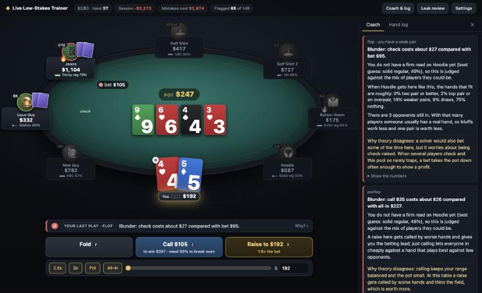

# Live Low-Stakes Trainer

A poker trainer for the games you actually sit in: live $2/$3 and $3/$5 no-limit hold'em.

You play an eight-handed table in your browser against the players you meet in a card room.
Every decision is scored by **how much money it makes against those players**, not by what
a solver would do. A play that is perfect in theory still gets flagged if it loses money
against a calling station, and a play a solver hates gets a green tick if it prints.



## Why not just study GTO?

Solvers assume opponents who bluff the right amount, fold the right amount and punish every
mistake. Low-stakes live players do none of that. They limp, call too much, rarely bluff
rivers, and almost never raise without a real hand. The profitable adjustments are large and
often the opposite of theory:

- fold one pair to a passive player's raise, however strong it looks
- bet bigger and thinner for value against players who do not fold
- stop bluffing people who call with any pair
- raise big over limpers instead of limping along

This trainer drills those adjustments by letting you make the decision and then showing what
it cost.

## Quick start

```bash
git clone git@github.com:pizzafx/poker_trainer.git
cd poker_trainer
npm start
```

Open http://localhost:5173. Needs Node 18 or later. There are no dependencies and no build step.

| Key | Action |
|---|---|
| `F` | Fold |
| `C` | Check or call |
| `R` | Bet or raise the amount shown |
| `Space` | Next hand (only needed after a flagged play) |

Click any opponent to see what you have observed about them.

## How a decision is judged

1. **Reads.** Each opponent has a hidden style and a visible look (ball cap and coffee, hoodie
   and headphones, loud guy on his third beer) that only loosely predicts it. As they bet,
   call, fold and show down hands, the trainer updates what an attentive player could
   conclude about them. That read, not the hidden truth, is what you are judged against.
2. **Ranges.** For every opponent still in the hand it works out which hands fit the way
   that kind of player has played so far.
3. **Run-outs.** It deals the opponents hands from those ranges and plays each of your
   options to the end of the hand, 800 to 3,000 times, on the same cards for every option.
4. **Verdict.** If your choice clearly loses money compared with the best option, it is
   flagged as a mistake (yellow) or blunder (red), with the cost in dollars, what the
   opponent's range looks like, and why theory disagrees.

Hands deal on automatically while your play is green. Anything flagged stops the table so
you can read why.

## The opponents

| Type | In one line |
|---|---|
| Tight-passive nit | Waits for big hands. When the money goes in, he has it. |
| Straightforward recreational | Bets when he hits, gives up when he misses. |
| Calling station | Sees lots of flops and hates folding a pair or a draw. |
| Gambler | Any two cards, calls far too much, fires the odd wild bluff. |
| Maniac | Raises and barrels constantly. Big bets mean much less from him. |
| Solver-style player | Small bets, balanced bluffs, by the chart whoever he faces. |
| Solid regular | Tight-aggressive grinder who isolates limpers. |
| Tricky regular | Plays many hands in position and applies pressure. |

Every player is their own variation of a type: a little looser or tighter, more or less
sticky. They buy in for different amounts (some sit short), leave, get replaced, and go on
tilt after losing a big pot. The table also remembers you: raise and bluff a lot and you
start getting called lighter.

## Features

- **Coach strip** under the table with the verdict on your last play, and a side panel with
  the full reasoning and the numbers behind it.
- **Leak review.** Mistakes are grouped into types (paying off, bluffing callers, missed
  value, sizing, preflop too loose or too passive, and more), ranked by cost, and tracked
  across sessions in your browser.
- **Drill mode.** Pick a leak and the trainer deals only that kind of spot, one after
  another, playing the earlier streets for you. One decision, one verdict, next spot.
- **Home game mode.** Set your own blinds and buy-in and choose exactly who sits down:
  three maniacs, two nits and a total beginner, say. No rake, everyone rebuys, and you
  know who is coming but not which seat is which.
- **Table types.** Typical, aggressive, conservative, or loose-passive: the same player
  types in a different mix.
- **Game settings.** $2/$3 or $3/$5, buy-in, and rake (Talking Stick Resort's listed
  structure by default, plus a capped percentage, a flat drop, or none).
- **Skip junk hands.** The bottom 15% of starting hands are folded for you, so you spend
  your time on decisions that matter.
- **Player notes.** How often each opponent has entered pots and raised, the hands they
  have shown down and how they played them, and the coach's current read, with a spoiler
  button for their true style.

## How far to trust it

Read this before taking the advice to a real table.

- **Only preflop tendencies are measured.** The one tracked sample of these games found
  about 35% of hands played, 6% raised preflop, four players to the flop, and limpers
  calling a raise 56% of the time. The opponents match those numbers. Nothing after the
  flop has been measured at these stakes, so every postflop number in
  `src/bots/profiles.js` is an assumption in the direction coaches agree on.
- **The opponents are easier to beat than real players.** A player who blindly follows the
  top-rated option wins several times what a strong live player makes. Trust the direction
  of the advice (value-bet more, pay off less, isolate limpers) more than the dollar
  figures.
- **Guardrails limit what gets flagged.** The trainer will not flag you for declining a
  bluff-raise, for not overbetting with one pair, or for passing on a thin river bluff, and
  it drops any flag that does not survive the opponents being a little looser or tighter
  than assumed. Those plays can score well against bots and lose money against people.
- **The numbers are estimates.** Options marked ≈ in the numbers table are too close to
  call.

The full research, with sources and a list of what could not be found, is in
[`reports/`](reports/).

## Checking the model

Everything the trainer believes can be inspected from the command line:

```bash
npm test                        # engine: hand ranking, betting, side pots, rake
node scripts/spots.js           # the judge on 13 set-piece spots with known answers
node scripts/calibrate.js       # stats that emerge from bot-vs-bot play, per player type
node scripts/audit.js 11 150    # hand histories behind the costliest verdicts
node scripts/selfplay.js        # win rate of a player who blindly follows the judge
node scripts/exploit.js         # where that player's profit comes from
node scripts/noise.js 3000      # how repeatable the judge's numbers are
```

If you disagree with how a type plays, change its numbers in `src/bots/profiles.js` (each
one is commented), rerun `calibrate.js` and `spots.js`, and reload the page.

## Project layout

```
src/engine/    cards, hand evaluator, betting rules, hand-strength reading
src/bots/      opponent profiles and the decision model
src/trainer/   session, reads, judge, feedback text, drills
src/ui/        the page
scripts/       checks and diagnostics
reports/       the research report behind the opponent model
research_notes/ raw notes from each research thread
```

## Ideas for later

- a separate player pool and opening sizes for $3/$5
- raise size as a tell (the small "click-back" raise from a passive player)
- step-through replay of flagged hands
- type in a real hand from last night and get the coach's view
- your own session stats with target ranges
- straddle options matching the room
